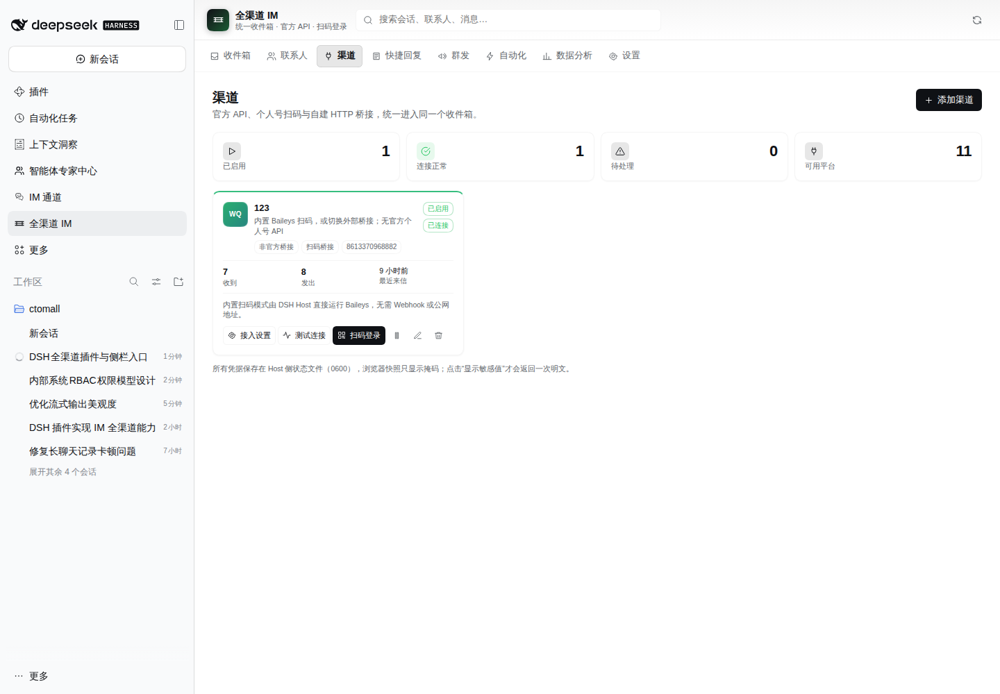
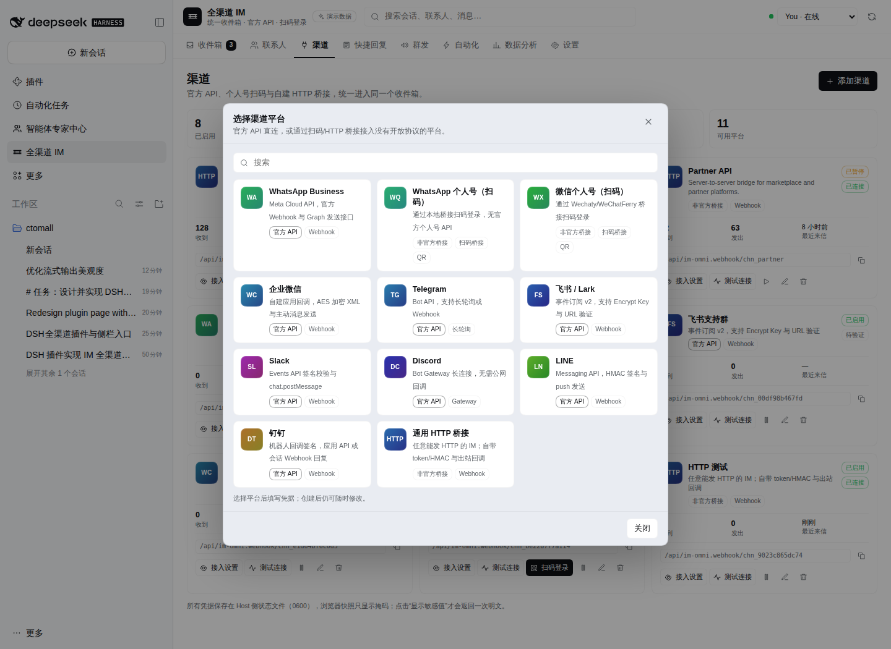
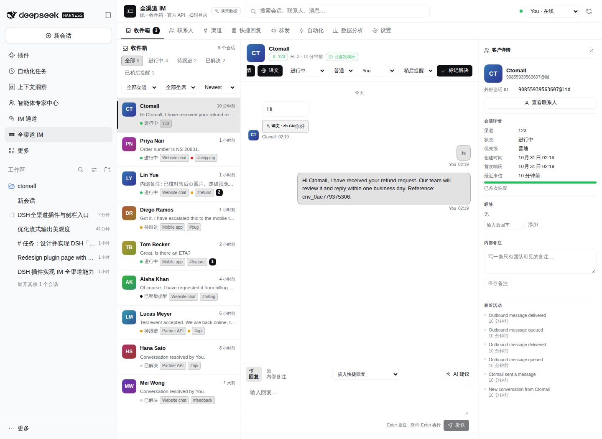
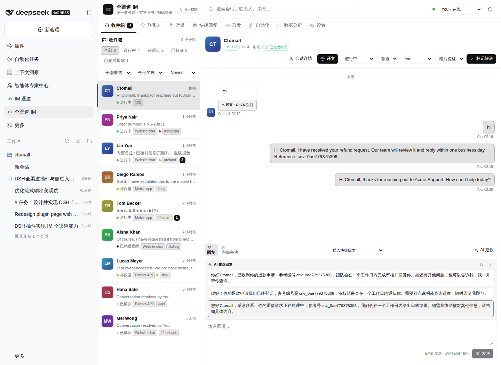
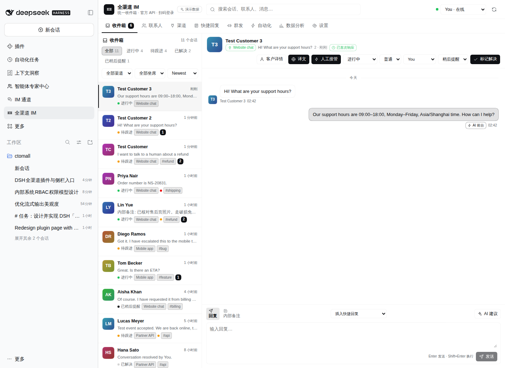
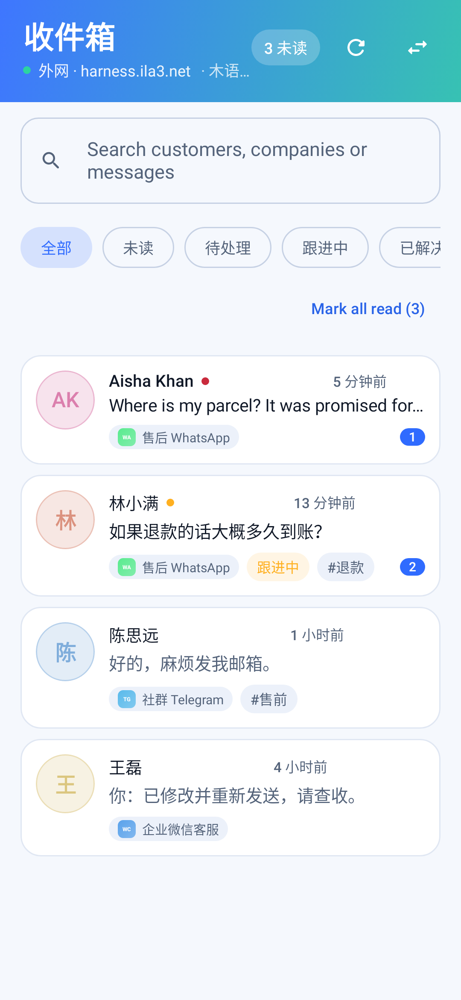
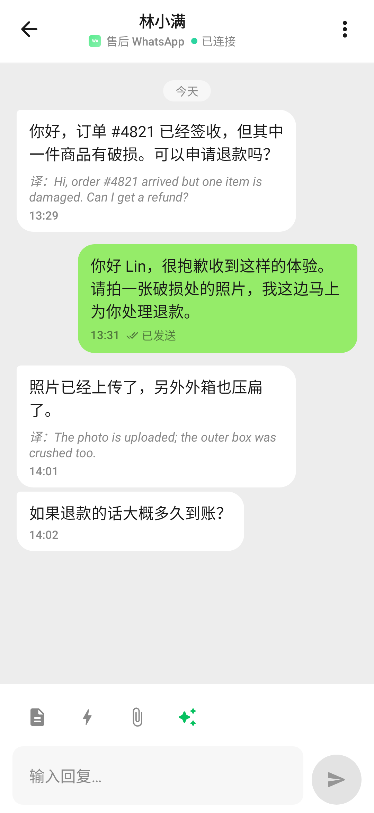
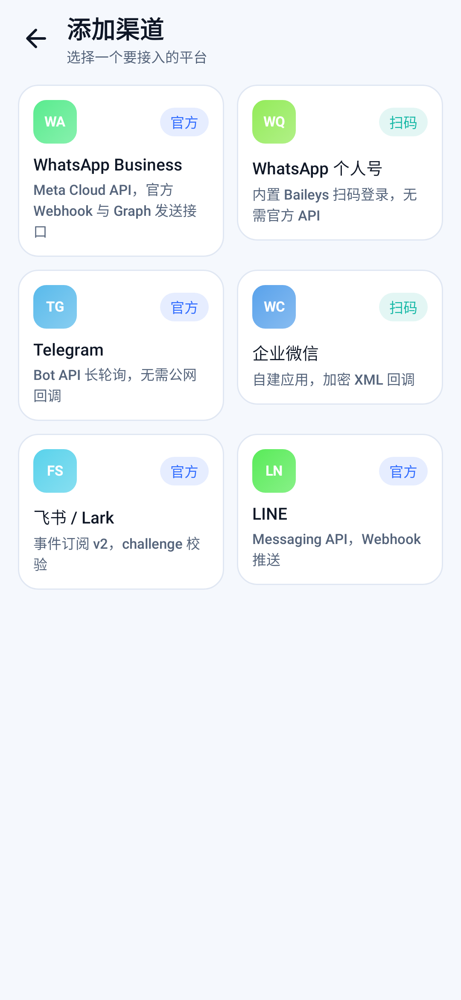
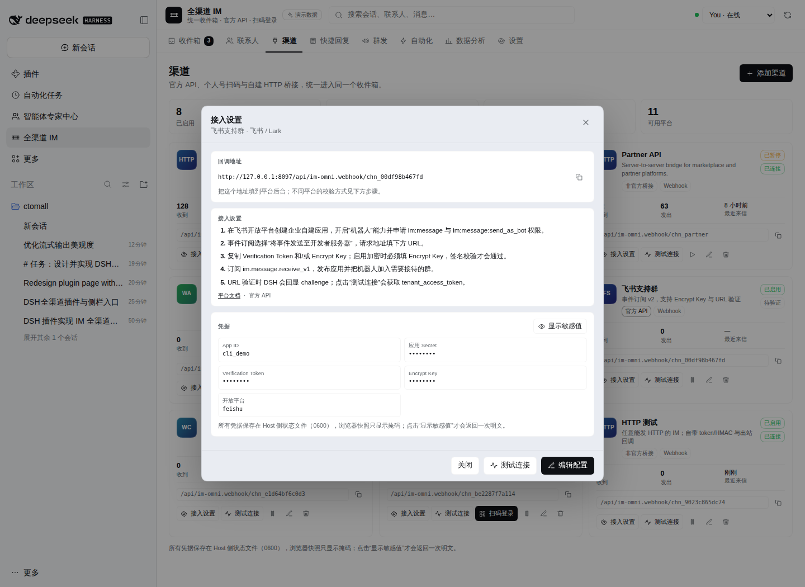
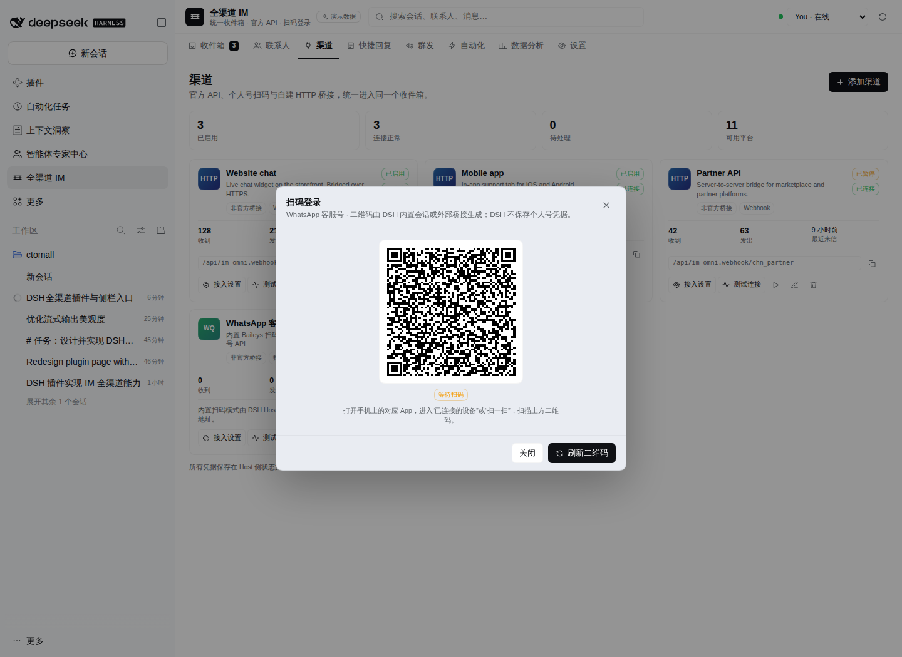

# 全渠道 IM（dsh-im-omni 2.7.1）

一个带左侧栏入口的 DSH Web 插件：把 WhatsApp Business、WhatsApp/微信个人号扫码、企业微信、Telegram、飞书、Slack、Discord、LINE、钉钉和自建 HTTP 桥接统一到一套收件箱、联系人、快捷回复、群发、自动化和分析里。

> 个人 WhatsApp / 微信没有官方 Bot API。WhatsApp 默认由 DSH Host 内置 Baileys 扫码；微信需独立 Wechaty 桥接，本仓库提供参考实现 [bridges/](./bridges/)。其余渠道都是官方 API 直连。



## 1. 交付内容

| 路径 | 内容 |
| --- | --- |
| `client.js` | 左侧栏入口 + 主面板：收件箱、联系人、渠道、快捷回复、群发、自动化、分析、设置 |
| `index.js` | Host 侧 API、供应商回调、出站投递、Telegram/Discord 长连接、定时群发 |
| `lib/channels/` | 11 种渠道适配器、配置校验、签名/解密、出站发送、二维码会话 |
| `lib/commands.js` / `lib/store.js` | 命令、持久化、公开快照与密钥脱敏 |
| `bridges/` | WhatsApp（Baileys）/ 微信（Wechaty）扫码桥接参考实现 |
| `docs/CHANNELS.md` | **每个渠道的配置方式、平台侧步骤、行为与限制** |
| `test/` | 适配器、签名/解密、入站/出站、脱敏的自动化测试 |
| `android/` | **Android 客户端源码、截图与构建产物**（见 [android/README.md](./android/README.md)） |
| `lib/app.js` | Android 在线升级：版本清单与安装包下发路由 |
| `locale/`、`icon.svg` | 插件管理页标题/描述与原创图标 |

数据文件：

```text
$DSH_PROFILE_DIR/.im-omni/state.json
# 或 $DSH_HOME/im-omni/<profile>/state.json
```

文件权限 `0600`，原子替换写入。

**新工作区默认是空白工作台，不再自动写入演示数据。** 已有演示数据可在「设置 → 退出演示模式」清理：只删除内置 fixture（3 个演示渠道、8 位联系人/会话、示例模板/规则/群发），保留你创建的真实渠道和会话。

## 2. 已接入渠道

| 平台 | 接入方式 | 入站 | 出站 | 说明 |
| --- | --- | --- | --- | --- |
| WhatsApp Business | Meta Cloud API | `X-Hub-Signature-256` Webhook | Graph `messages` | 官方；24h 窗口 |
| WhatsApp 个人号 | 内置 Baileys 扫码（可切外部桥接） | Socket 直连 | Socket | 非官方；默认可直接用 |
| 微信个人号 | 外部 Wechaty QR bridge | 桥接 POST + bearer | 桥接 `/messages/send` | 非官方；需桥接 |
| 企业微信 | 自建应用 | 加密 XML + `msg_signature` | `message/send` | 官方；AES-256-CBC |
| Telegram | Bot API | 长轮询或 Webhook secret | `sendMessage` | 官方；无需公网也可 |
| 飞书 / Lark | 事件订阅 v2 | challenge + SHA256/AES | `im/v1/messages` | 官方 |
| Slack | Events API | `X-Slack-Signature` | `chat.postMessage` | 官方 |
| Discord | Bot Gateway v10 | WebSocket 长连接 | `channels/{id}/messages` | 官方；无需回调 |
| LINE | Messaging API | `X-Line-Signature` | push API | 官方 |
| 钉钉 | 企业内部机器人 | `timestamp`/`sign` | 应用 API 或 sessionWebhook | 官方 |
| 通用 HTTP | 自建桥接 | token / HMAC | outbound URL + HMAC | 任意 IM |



**完整的平台后台配置步骤见 [docs/CHANNELS.md](docs/CHANNELS.md)。**

## 3. 客服工作台

- **客户详情默认隐藏**：右侧栏初始不占宽度；点会话头部的「会话详情」打开，右上角 × 关闭；窄屏下以抽屉覆盖显示。
- **自动全语言翻译**：设置 → 翻译与 AI 选择目标语言（默认 `zh-CN`）。打开会话时自动把客户消息译为目标语言，原文与译文同时保留；标题栏「译文」可一键隐藏。Host 优先使用 DSH `translator` 服务；未挂载时回退到 Google Translate 公共端点，并记录检测到的源语言。
- **AI 建议回复**：回复框右侧「AI 建议」使用 DSH 当前默认模型，结合最近会话生成 3 条草稿；检测到客户语言时用客户语言生成，否则用目标语言；点击草稿填入输入框，**不会自动发送**。可在设置中关闭。
- **自动接待机器人**：设置中启用后，新客户消息由默认模型自动回复；支持接待规则、欢迎语、转人工关键词、最大自动轮次。命中关键词/达到轮次/模型判断需要人工时，会话转「待跟进」并暂停机器人；人工发送回复会自动接管，可在会话头「恢复 AI」。
- 翻译/AI 走独立的 `/api/im-omni.ai` owner-authenticated 路由，不阻塞收发命令。

> 隐私提示：使用 Google 回退时，消息文本会发送到 Google；对数据出境敏感的场景请挂载 DSH `translator` 的本地/企业 provider，或关闭自动翻译。







## 4. 左侧栏入口

`client.js` 注册同一个 id 的两处 slot：

```js
ctx.slots.inject('sidebar.panellist', () => ctx.slots.register({
  name: 'sidebar.panellist',
  id: 'im-omni',
  order: 46,
  locale: NS,
  label: () => t('panel.label'),
}, PanelIcon))

ctx.slots.inject('main', () => ctx.slots.register({
  name: 'main',
  key: 'im-omni',
  locale: NS,
}, App))
```

点击左侧栏 **全渠道 IM** 打开面板，默认收件箱；顶部页签切换渠道、联系人等。`ctx.slots.inject` 在插件卸载/折叠时自动释放。

## 5. 安装

插件已在当前 profile 安装。部署到其他 profile：

```text
plugin_manager action=install_bundle target=/home/ubuntu/ctomall/im-omni
```

`cordis.patch.yml`：

```yaml
- insert:
    - id: im-omni
      name: 'dsh-im-omni'
```

替换已安装版本后按 Plugin Manager 的 `application`/`nextStep` 处理；Host 代码更新通常需要重载/重启插件进程。浏览器客户端是 immutable bundle，更新后必须硬刷新（Ctrl/Cmd+Shift+R）或关闭标签页重开，否则会出现“能看到新平台、保存仍走旧逻辑”的混合状态。

## 5.1 Android 客户端

仓库内置原生 Android 前端（`com.ila3.dshomni`），手机上是同一套收件箱与渠道数据，只是换了渲染层：

- **配对**：复用 DSH `phone_remote` 的一次性配对码与设备 cookie，不新增口令；内网（`http://<局域网 IP>:8080/phone/`）与外网（`https://域名/phone/`）各配对一次后一键切换。
- **功能**：收件箱筛选与搜索、会话收发 / 翻译 / AI 草稿、渠道列表与详情、**手机端新增渠道并扫码绑定个人号**、工作台开关。
- **在线升级**：Host 自身下发安装包，手机校验 SHA-256 后安装。

| 收件箱 | 会话 | 新增渠道 |
| --- | --- | --- |
|  |  |  |

构建与截图：

```bash
cd android
./build.sh              # dist/dsh-im-omni-<version>.apk + dist/latest.json
CAPTURE=1 ./build.sh    # 顺带重跑 Robolectric 截图到 android/docs/
```

**升级链路**：`GET /api/im-omni.app.version` 返回 `{ versionCode, versionName, sha256, size, apkPath }`（读 `android/dist/latest.json`），`GET /api/im-omni.app.apk` 读同目录安装包。两个路由都注册在 `ctx.connection.fetch`，必须携带配对后的设备 cookie，安装包不会公开暴露。发布新版本只需改 `android/app/build.gradle` 的版本号并重跑 `build.sh`，**不必重新发布插件**。

## 5.2 插件自更新

插件从 Git 目录安装（`link:` 或 `git+https://…`）时，「设置」页会出现**插件更新**卡片：

- **检查更新**：在插件目录执行 `git fetch`，对比 `HEAD` 与 `origin/<branch>`，显示当前提交、落后/领先多少个提交，以及待拉取的提交列表。
- **立即更新**：执行 `git pull --ff-only`，只允许快进合并。

安全边界：

- 路由 `POST /api/im-omni.upgrade` 挂在 `ctx.connection.fetch`，**只有 Owner 会话**能调用；请求体只接受 `check` / `pull` 两个动作，路径固定为插件自己的目录，不接受任何外部传入的路径或参数。
- **工作区有未提交改动时一律拒绝更新**，避免覆盖正在改的代码；远程不可达时也不会伪装成「已是最新」。
- 只做 `--ff-only`：出现分叉（本地领先且落后）不会自动合并，需要人工处理。

**已知限制**：`git pull` 只改磁盘文件，Host 已加载的 JS 模块不会热替换。更新成功后卡片会提示「重载插件（或重启 DSH）后生效」；若 `client.js` 有变化，浏览器还需硬刷新。这也是更新按钮不假装已经生效的原因。

如果插件是作为 npm 包安装的（没有 `.git`），卡片会直接说明「当前不是 Git 目录安装，无法自更新」。

---

## 6. 新渠道怎么加

1. 渠道页 → **添加渠道** → 选平台。
2. 填写凭据；带「可选」的字段可留空。敏感字段已配置时留空表示保留旧值。
3. 保存后打开 **接入设置**：复制回调地址、按步骤配置平台后台、按需「显示敏感值」。
4. 点 **测试连接**，再发真实消息验收入站。
5. 个人号点 **扫码登录**，二维码由桥接返回；DSH 不保存个人号凭据。





> 截图来自隔离的演示实例，渠道名与凭据均为占位数据；真实平台需要按下方文档配置。

## 7. 协议与安全

- 浏览器 API：`/api/im-omni.state`、`/api/im-omni.command`，走 DSH 的 owner-authenticated Fetch 路由。
- 公开回调：`/api/im-omni.webhook/<channelId>`，按渠道类型验签；限流 120 次/分钟/渠道，body 上限 256 KiB。
- 敏感字段在公开快照中替换为 `••••••••`；`configuredSecrets` 只暴露是否已配置。只有显式 `channel.revealSecret` 才返回明文。
- 每个渠道都有固定窗口限流；入站按 `externalMessageId` 幂等。
- 出站失败记录在消息和渠道卡片上，可重试；暂停渠道时入站/出站均拒绝。
- 凭据存储在 Host 侧 JSON，依赖文件权限而不是数据库；如需 KMS/凭据库，可在 `Store` 前接入 DSH credential service。

## 8. 验证

```bash
cd im-omni
node --test test/*.test.js
```

覆盖：

- 11 个平台目录项、自动生成 token、必填校验；
- WhatsApp Cloud challenge/签名/消息归一化；
- Telegram secret token/消息；
- 飞书 challenge、SHA256 签名、AES 解密；
- 企业微信 GET 验证、加密 XML、`msg_signature`；
- Slack/LINE/钉钉/Discord 签名与归一化；
- QR bridge 状态、入站 bearer、二维码 data URL；
- 创建渠道 → 入站 → 出站完整链路（mock 供应商 API）；
- 公开快照不泄漏 secret。

当前环境无真实供应商凭据，因此只验证了协议、签名、mock 出站和 DSH UI；真实平台连通性需要按 [docs/CHANNELS.md](docs/CHANNELS.md) 填入凭据后验收。

## 9. 依赖

源码运行/本地 link 安装时，先在插件目录安装扫码依赖：

```bash
cd /home/ubuntu/ctomall/im-omni
npm install
```

`baileys` 与 `qrcode` 只在 WhatsApp 个人号内置扫码时使用；不启用该渠道不影响其他平台。

## 10. 边界

- WhatsApp 个人号默认内置 Baileys；也可切换外部桥接。微信个人号仍需外部桥接。参考桥接未做真机验证，非官方协议有封号/合规风险。
- 文本收发完整；图片/文件目前保留占位与元数据，不转存媒体。
- WhatsApp 模板消息、群发合规/退订、多租户/坐席独立登录不在本次范围。
- 单 Host、单工作区 JSON 状态；多实例共享需换成外部数据库/队列。
- 所有回调必须能被平台访问；本地 HTTP 仅适合 Telegram 长轮询、Discord Gateway 和本机桥接。

详细待确认项见 [PENDING.md](./PENDING.md)。
