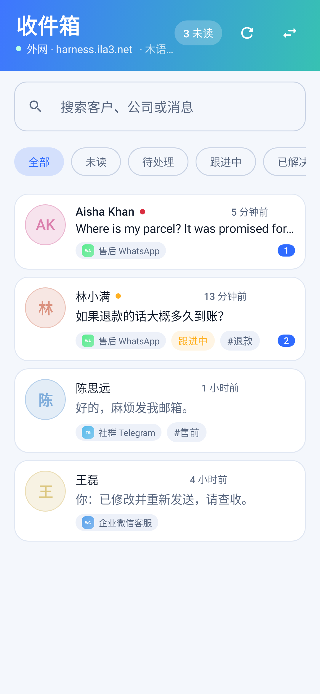
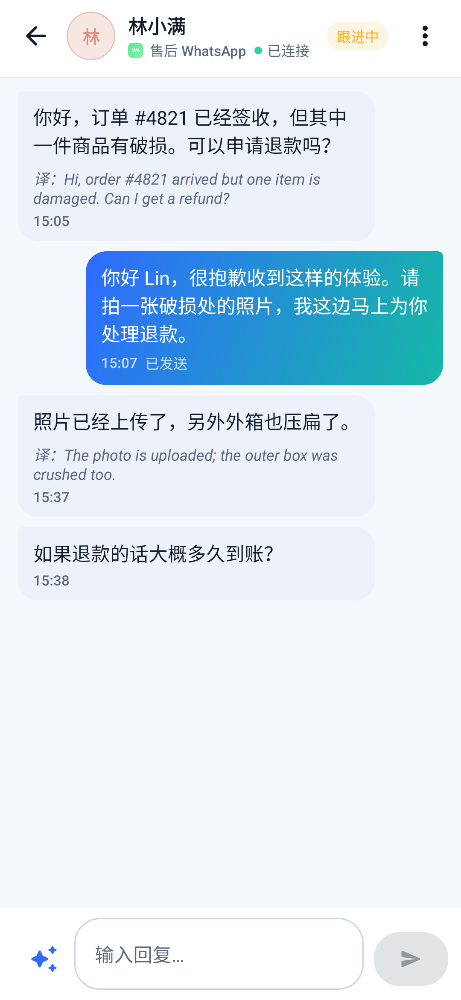
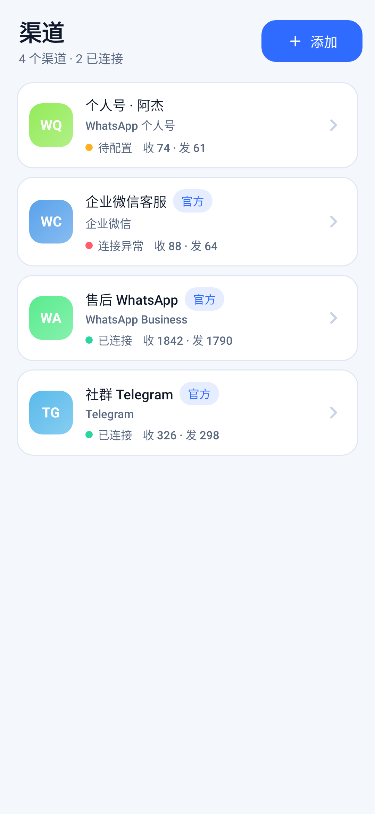
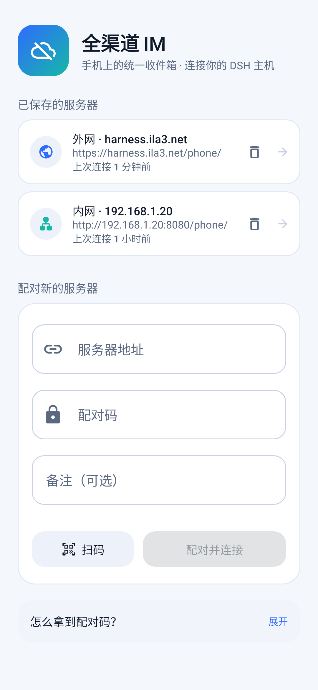
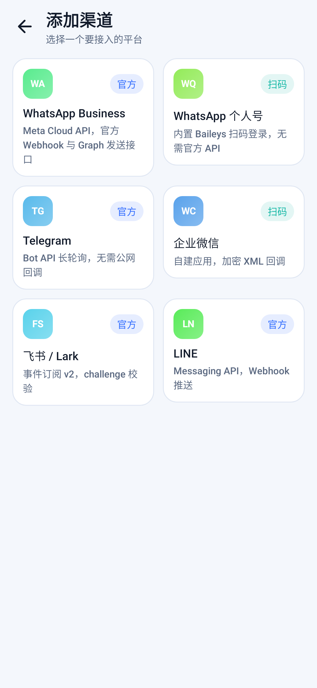
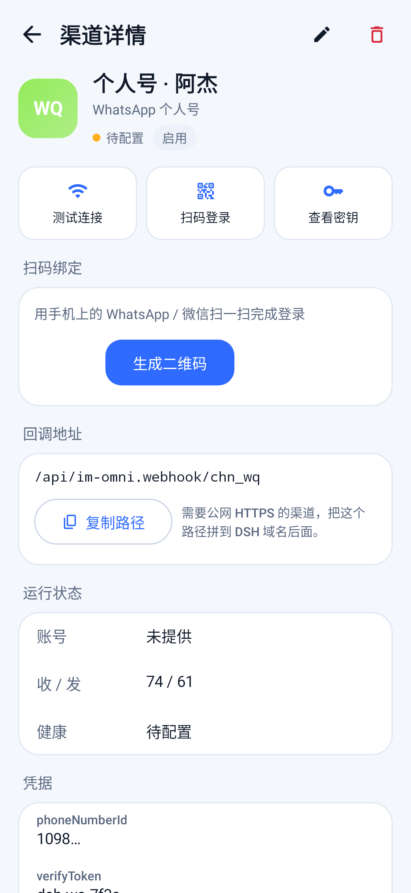
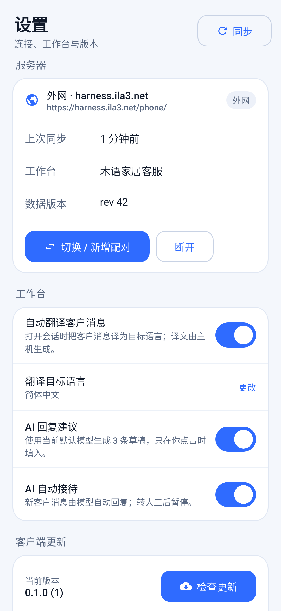
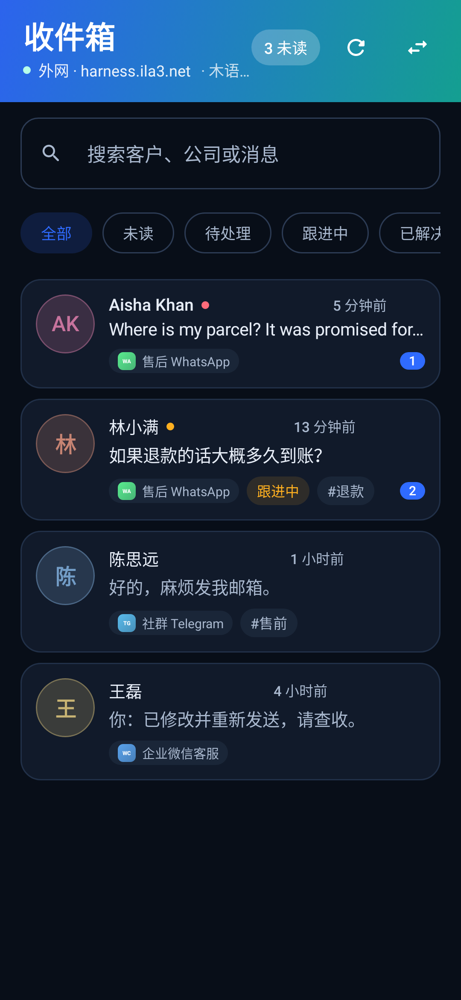
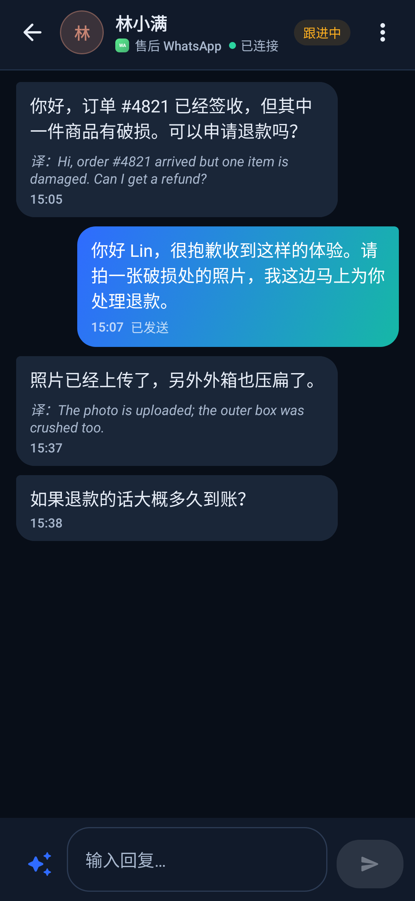

# 全渠道 IM · Android 客户端

`dsh-im-omni` 的手机前端：把插件里的收件箱搬到手机上，支持**在手机上配对服务器、新增渠道、扫码绑定个人号、远程收发消息，并在应用内升级**。

- **应用 ID**：`com.ila3.dshomni`，Compose + Material 3，`minSdk 26 / targetSdk 34`。
- **连接**：复用 DSH 自带的一次性配对码和设备 cookie，不新增任何鉴权口令；内网与外网是两个独立入口，配对后一键切换，不用反复要验证码。
- **同一份数据**：手机与 Web 侧的左侧栏读写同一个 Host 文档，不存在两套收件箱。
- **在线升级**：安装包由插件本身下发（`/api/im-omni.app.version`、`/api/im-omni.app.apk`），下载后校验 SHA-256 再交给系统安装器。

## 界面

| 收件箱 | 会话 | 渠道 |
| --- | --- | --- |
|  |  |  |

| 配对 | 新增渠道 | 渠道详情 | 设置 |
| --- | --- | --- | --- |
|  |  |  |  |

深色模式：

| 收件箱（深色） | 会话（深色） |
| --- | --- |
|  |  |

> 以上截图不是设计稿，是 `OmniScreenshotTest` 用 Robolectric 真实渲染 Compose 帧导出的 PNG（411×891dp / xxhdpi），随代码更新。

## 功能范围

**收件箱**
- 全部 / 未读 / 待处理 / 跟进中 / 已解决 筛选，搜索客户、公司与消息正文。
- 未读角标、优先级圆点、渠道徽标、标签；每 20 秒静默刷新，下拉按钮手动刷新。

**会话**
- 收发消息（Host 队列化，气泡显示「发送中 / 已发送 / 发送失败」）。
- 客户消息自动翻译（译文与原文并存），AI 生成 3 条草稿，点击填入、不自动发送。
- 标记已读、改状态、暂停 / 恢复 AI 接待。

**渠道**
- 列表带健康状态与收发统计；详情可测试连接、复制回调路径、查看 / 轮换密钥、暂停、删除。
- **手机端新增渠道**：平台选择 → 按 Host 目录动态渲染表单（必填校验、密钥显隐、下拉选项、平台侧配置步骤）。
- **扫码绑定个人号**：WhatsApp / 微信个人号的二维码在手机上直接显示，3 秒轮询登录状态。

**连接与升级**
- 保存多台服务器（内网 / 外网 / 自定义），列表一键切换，删除即清除该入口的 cookie。
- 设置里可改自动翻译、目标语言、AI 建议、AI 接待。
- 检查更新 → 显示版本与更新说明 → 下载（带进度）→ SHA-256 校验 → 安装。

## 配对流程

1. 在电脑的 DSH 会话里让 Agent 执行 `phone_remote` 工具的 `pair`，得到配对码与二维码。
2. 手机打开 App：扫码，或手填地址 + 配对码。
   - 内网：`http://<电脑局域网 IP>:8080/phone/`
   - 外网：`https://你的域名/phone/`
3. 配对成功即写入设备 cookie（`dsh_phone` + DSH 会话），之后的请求都走这条 cookie。

内网与外网是不同 host，cookie 按 host 隔离，所以两个入口各配对一次；之后在「已保存的服务器」里切换。

## 构建

需要 JDK 17 与 Android SDK（`platforms;android-34`、`build-tools;34.x`）。

```bash
cd android
./build.sh                # 生成 dist/dsh-im-omni-<version>.apk + dist/latest.json
CAPTURE=1 ./build.sh      # 顺带重跑 Robolectric 截图到 docs/
```

`local.properties` 里的 `sdk.dir` 指向本机 SDK；`build.sh` 也从 `ANDROID_HOME` 或 `~/android-sdk` 推断。

**发版**：改 `app/build.gradle` 里的 `versionCode` / `versionName` → `./build.sh` → 提交 `dist/` 与源码。插件读 `android/dist/latest.json` 把新版本推给已配对的手机，无需重新发布插件。

## 在线升级是怎么工作的

```
手机 ──GET /api/im-omni.app.version──▶ 插件（读 android/dist/latest.json）
     ◀── { versionCode, versionName, sha256, size, apkPath }
手机 ──GET /api/im-omni.app.apk──────▶ 插件（读同目录 APK）
     ◀── 安装包字节流
手机：校验 SHA-256 → FileProvider → 系统安装器
```

两个路由都注册在 `ctx.connection.fetch`，也就是**必须携带配对后的设备 cookie**；安装包不会公网裸奔。手机侧只允许 `versionCode` 更高时才提示升级，防止降级安装。

## 代码结构

```
app/src/main/java/com/ila3/dshomni/
├── MainActivity.kt              // 单 Activity，接收 dshomni://pair 深链
├── data/
│   ├── model/Models.kt          // Host 快照的 Kotlin 模型
│   ├── local/CookieStore.kt     // 持久化 cookie jar（配对后免登录）
│   ├── local/ConnectionStore.kt // 已保存的内网/外网入口
│   ├── remote/PairingLink.kt    // 配对链接/地址/配对码解析
│   ├── remote/ApiClient.kt      // state / command / ai / version / apk
│   └── remote/DtoParser.kt      // 容错解析，缺字段不炸整个收件箱
├── ui/
│   ├── OmniViewModel.kt         // 所有状态与命令
│   ├── RootApp.kt               // 路由与底部导航
│   ├── inbox|chat|channels|settings|pairing/
│   └── PreviewData.kt           // 截图用的演示数据
└── util/                        // 时间格式、SHA-256、APK 安装、二维码解码
```

## 测试

```bash
./gradlew testDebugUnitTest
```

- `PairingLinkTest`：配对链接 / 裸地址 / 裸 IP / 自定义入口的解析。
- `DtoParserTest`：快照、平台目录、更新清单解析，以及残缺记录的降级。
- `OmniScreenshotTest`（浅色）、`OmniDarkScreenshotTest`（深色）：真实渲染九屏 PNG。

## 已知边界

- **UI 只有中文**：与服务端目录的 `zh/en` 双语不同，客户端文案尚未抽取资源。渠道名、字段标签等来自 Host 的文案会跟随插件语言。
- **不支持离线写**：所有操作都需要连上 Host；断网时只保留最后一次快照。
- **富媒体只读文本**：图片 / 语音消息目前以文本占位显示，尚未做下载预览。
- **升级需允许安装未知来源**：首次安装会跳系统设置页授权一次。
- **未做推送**：没有常驻通知或 FCM，靠前台轮询；后台不刷新。
