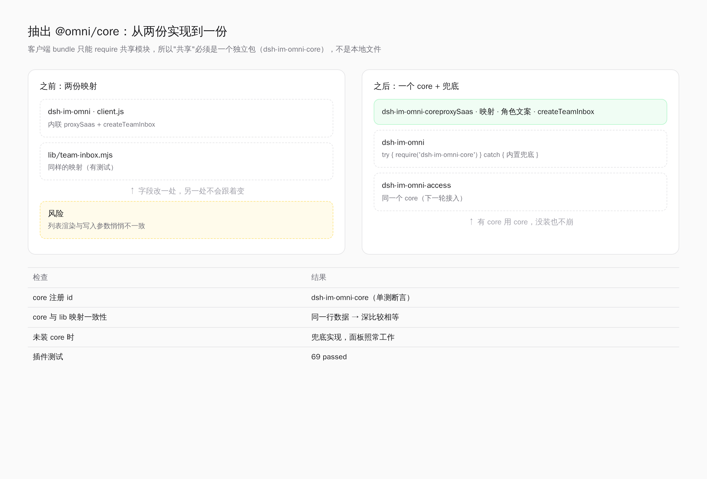
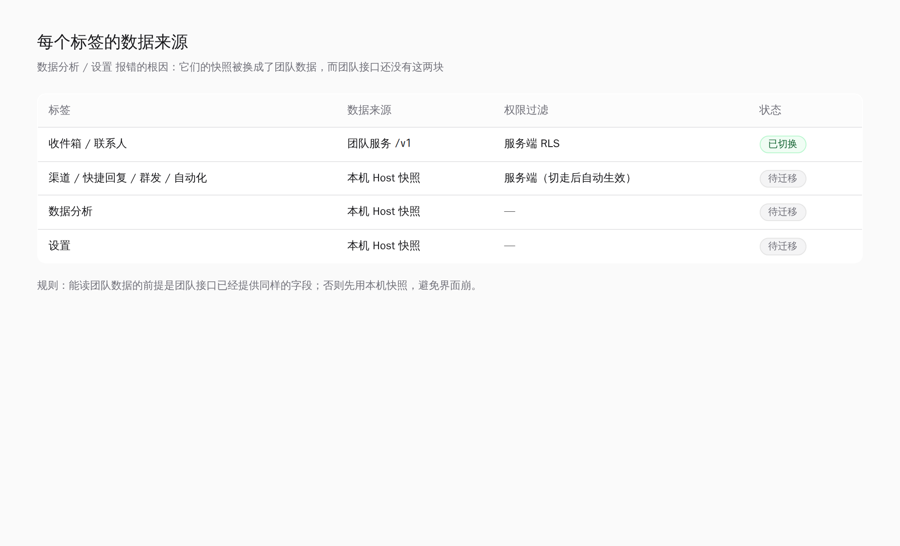

# dsh-im-omni 架构（按"多人共用"重排）

> 出发点（来自产品要求）：多人共用一套收件箱；渠道号码与数据按员工权限隔离；隔离必须由服务端强制；
> 功能要长在插件里，而不是另开一个要让用户记地址的站点；每个事实只有一个真源。


## 1. 四个运行单元

| # | 单元 | 位置 | 职责 | 不做什么 |
| --- | --- | --- | --- | --- |
| ① | 插件 UI | `client.js`（DSH 页面内） | 收件箱、渠道、团队权限、设置、详情页配置 | 不做权限判断；不直连团队 API |
| ② | Host 半边 | `index.js` + `lib/*` | 本机能力（命令/媒体/通知/升级）、API 兜底代理 | 不再是团队数据真源 |
| ③ | 接入层 | nginx `/im-omni-api/` | 同源转发到 team-api | 不做业务判断 |
| ④ | 团队服务 | `server/`（Node + Postgres） | 鉴权、成员与授权、审批、审计、设置 | 不做界面 |

## 2. 一条主链路（读数据）

```
面板 proxySaas('/v1/...')            ← 只带 JWT，不带 tenant 猜测
  → /im-omni-api/v1/...              ← 同源：无 CORS、无混合内容
    → authenticate()                 ← JWT → userId
      → withTenant(tenantId, fn, userId)   ← 事务内 SET app.tenant_id / app.user_id
        → Postgres RLS               ← 行级策略决定"看得见哪些行"
          → 403 out-of-scope / 404 not-found
```

**关键点**：隔离发生在数据库，不在 UI。"前端隐藏"从来不算隔离。

## 3. 权限模型（单一规则，两处使用）

| 概念 | 存储 | 说明 |
| --- | --- | --- |
| 角色 | `memberships.role` | owner / admin / agent / viewer，提供**默认**范围 |
| 成员授权 | `memberships.permissions` | `dataScope`（all/own）+ `channelIds`，**覆盖默认** |
| 生效判定 | `app_scope()` / `app_channel_ids()` | SQL 函数，策略直接调用 |
| 危险操作 | `confirmEmail` + `approval_requests` + `audit_logs` | 确认 → 复核 → 追溯 |

角色只决定默认值；"这个人能看什么"永远由 `permissionOf()` 的合成结果回答。

## 4. 危险操作三件套

```
改可见范围 / 改角色 / 移除成员 / 删渠道
  ├─ 1. 确认：必须输入目标邮箱（防误触）
  ├─ 2. 复核：管理员 → approval_requests(202)；所有者 → 直接执行
  └─ 3. 追溯：变更与审批同事务写 audit_logs
```

## 5. 边界规则（防止再次跑偏）

| 关注点 | 唯一负责方 | 明确禁止 |
| --- | --- | --- |
| 谁能看哪些号码/会话 | team-api + Postgres RLS | 前端过滤、按 UI 隐藏 |
| 权限变更历史 | `audit_logs` | Host JSON、插件本地文件 |
| 用户入口 | 插件面板「团队权限」 | 让用户记 `:8090/admin` |
| 本机离线数据 | Host `store.js` | 与团队数据双写 |
| 升级来源 | Host `lib/upgrade.js` | 把 github.com 当单点 |

## 6. 现状 vs 目标

| 项 | 现状 | 目标 | 差距 |
| --- | --- | --- | --- |
| 面板入口 | 已有「团队权限」标签页 | 唯一入口 | ✅ |
| 详情页配置 | 登录后走 v1，未登录走 Host | 只保留登录态路径 | 🟡 双路径并存 |
| 团队数据 | team-api 为准 | 唯一真源 | 🟡 Host store 仍存历史字段 |
| 管理页 | `:8090/admin` 仍可访问 | 降级为运维只读 | 🟡 两个界面 |
| 升级 | 依赖 github.com | remote 可配置 + 备用源 | ❌ 未做 |
| Host 代理 | 已实现 `/api/im-omni.saas` | 保留为兜底 | ✅ |

## 7. 迁移顺序（每步可验收）

1. **收口入口**：详情页配置去掉"未登录写本机"分支，统一要求登录（离线只读快照）。
2. **收口数据**：Host store 只保留 `token`、`lastSnapshot` 与本机渠道配置，不再存成员/权限。
3. **收口管理页**：`:8090/admin` 加开关默认关闭，仅运维只读；所有写操作从面板发起。
4. **升级解耦**：`IM_OMNI_UPGRADE_REMOTE` 支持自定义 remote / 备用源，GitHub 不可用时可切换。
5. **通知升级**：审批与提醒同时支持企业微信与站内（面板红点）。

## 8. 验收口径

- `node --test`（server 87 + 插件升级/代理 14）全绿；
- 越权访问返回 403 且不泄露名字；跨租户返回 404；
- 授权变更下一次请求即生效（无缓存）；
- 面板内完成：登录 → 授权 → 提案 → 批准 → 审计可见；
- `origin/main == HEAD`。

## 9. 要不要拆成「聊天 / 权限 / 配置」三个插件包？


**结论：现在不拆，先把"缝"留在模块边界上；满足触发条件再拆。**

### 9.1 为什么现在不拆

1. **拆包不拆数据**：三个包仍然调同一个 team-api。权限安全来自服务端 RLS，和有几个包无关。
2. **登录态成本**：DSH 每个插件包是独立面板与独立宿主上下文。拆开后要么三次登录，要么做一个
   `@omni/core` 共享包（session + proxy + 类型）。没有 core 就拆 = 三份代理、三套真相。
3. **当前体量**：`client.js` 一个包，三个视图共享一次登录、一次构建、一次回滚，边际成本最低。
4. **前车之鉴**：我们刚因为"两个真相"（Host store vs SaaS、`:8090/admin` vs 面板）返工过两次。
   拆包会再制造一次同类风险。

### 9.2 现在该做的：把模块缝留好

| 模块 | 现有落点 | 拆分时会变成 |
| --- | --- | --- |
| chat（收件箱/渠道/群发） | 面板 `tab` 视图 | `@omni/chat` |
| access（成员/审批/审计） | `TeamView` + `/v1/members`、`/v1/approvals` | `@omni/access` |
| settings（通知/接待/升级） | 详情页四组 + `SettingsView` | `@omni/settings` |
| 共享 | `proxySaas()`、登录态、错误语义 | `@omni/core` |

**硬约束**：任何视图不得自行拼 API 地址或自己解析 token——只允许经 `proxySaas()`，这样拆包时
core 可以原样抽走。

### 9.3 什么时候真的拆

| 触发条件 | 结论 |
| --- | --- |
| 权限 UI 需要独立安装给管理员（聊天的 agent 不需要） | 拆 |
| 发布节奏不同（聊天周更、权限月更），回滚要互不影响 | 拆 |
| 不同负责人/团队，需要合同化边界 | 拆 |
| 只是"结构上觉得应该分" | 不拆，继续分模块 |

### 9.4 若拆，按这个顺序

1. 先抽 `@omni/core`（proxySaas / session / 错误码 / 类型），主包改为依赖它——**功能零变化**；
2. 把 access 视图整块搬到 `@omni/access`，复用 core；
3. 最后搬 settings；
4. team-api 不动：服务端永远是唯一的权限与数据真源。

### 9.5 落地结果（按"管理员单独装、客服只装聊天"执行）

| 包 | 装给谁 | 内容 | 状态 |
| --- | --- | --- | --- |
| `dsh-im-omni` | 客服 | 收件箱、渠道、模板、群发、自动化、数据分析、设置、详情页配置 | ✅ 已移除「团队权限」标签 |
| `dsh-im-omni-access` | 管理员 | 团队权限面板：登录 → 成员授权 → 审批 → 审计 | ✅ 已建包并 link 进 profile |

- 访问插件独立包：`/home/pro/dsh/dsh-im-omni-access`（自带 `package.json`、`cordis.patch.yml`、
  侧栏入口 order 47、Host 兜底代理 `/api/im-omni-access.saas`）。
- profile 注册：`~/.dsh-src/profiles/web/package.json` 增加 `link:` 依赖与 bundles 条目，`pnpm install` 已链接。
- **生效需要重启 dsh**（宿主侧插件在启动时加载）；重启后侧栏会多出「团队权限」，聊天面板不再有该标签。
- team-api 未改动：两个包共用同一服务与同一套 RLS。

### 10. 打开即登录，权限决定界面

面板不再"打开就是收件箱"，而是先过一道闸：

```
打开面板
  ├─ 本地有 token → /v1/me 校验 → 有效则进入
  ├─ 无 token / 失效 → 登录页（邮箱 + 密码），登录后存 token
  └─ 进入后：角色决定可见标签与可做操作（服务端返回，前端只按结果渲染）
```

| 角色 | 可见标签 | 不可见 |
| --- | --- | --- |
| owner / admin | 全部 | — |
| agent | 收件箱、联系人、快捷回复、数据分析、设置 | 渠道、自动化、群发 |
| viewer | 收件箱、联系人、数据分析、设置 | 同上 + 只读 |

- token 存 `localStorage['im-omni.session']`；失效自动清除并回到登录页。
- 越权标签即使被强行切过去，也会立刻回落到收件箱，且数据仍受服务端 RLS 约束（前端隐藏只是体验层）。

截图：`docs/panel-login-gate.png`。

### 11. 数据收口（第 1 步）：收件箱读团队服务

登录后，收件箱不再读本机 Host 快照，而是读团队服务——**列表本身已由行级策略过滤**：

| 动作 | 接口 | 说明 |
| --- | --- | --- |
| 会话列表 | `GET /v1/conversations?limit=30` | 只返回该成员可见的行 |
| 联系人/渠道 | `GET /v1/contacts`、`GET /v1/channels` | 同样受策略约束 |
| 会话消息 | `GET /v1/conversations/{id}/messages` | 前 8 个会话自动补水 |
| 标记已读 | `POST /v1/conversations/{id}/read` | |
| 改状态/优先级/标签/静音 | `PATCH /v1/conversations/{id}` | |
| 发送回复 | `POST /v1/messages` | 越权返回 403 out-of-scope |

- 映射逻辑有两份：`lib/team-inbox.mjs`（带 6 条单测）与 `client.js` 内联副本
  （客户端 bundle 只 `require` 共享依赖，无法直接 import 本地模块）。**这是已知债务**，
  等 `@omni/core` 抽出后合并。
- 未接入的操作会明确报错「这个操作还在本机模式下，尚未接入团队服务」，不静默失败。
- 其余标签（渠道配置、模板、群发、自动化）仍用本机数据，等后续步骤收口。

### 12. 抽出 core：共享实现从"约定"变成"模块"



| 项 | 内容 |
| --- | --- |
| 包 | `core/`（包名 `dsh-im-omni-core`，独立 socket：`index.js` + `client.js` + `cordis.patch.yml`） |
| 导出 | `proxySaas`、`toConversation`、`toMessage`、`membershipLabel`、`createTeamInbox` |
| 消费 | 聊天面板 `require('dsh-im-omni-core')`，失败时用内置兜底，**没装也不崩** |
| 校验 | `test/core-module.test.js`：注册 id 正确；同一行数据下 core 与 `lib/team-inbox.mjs` 深比较相等 |
| profile | `dsh-im-omni-core` 与两个插件一起 link 进 profile，`pnpm install --offline` 已生效 |

为什么不是"本地文件共享"：客户端 bundle 只能 `require` 模块系统里的包（`dsh.client.external`），
本地相对路径不会被解析——所以共享必须做成独立包。

剩余：权限插件下一轮改用它；聊天里的兜底副本等真实页面验证通过后删除。

### 13. 权限插件接入 core，并修正加载方式

**一个差点翻车的发现**：`dsh-im-omni-access` 最初写成 ESM（`import React from 'react'`），
而 DSH 的客户端 bundle 必须用 `window.__ModuleLoader__.load({ id, factory(require) })` 形式注册——
按原写法，重启后它**根本不会加载**。已重写为 loader 形式，并由单测锁住：

| 检查 | 断言 |
| --- | --- |
| 注册 id | `dsh-im-omni-access` |
| 导出 | 工厂返回 `{ apply }` |
| 依赖 core | 向模块系统请求 `dsh-im-omni-core` |
| core 缺失 | 仍能构造 `apply`（兜底），不崩 |

两个插件包现在都在产品仓库内：`core/`、`access/`，profile 用 `link:` 指向它们，
一起提交、一起回滚，各自仍是独立包与独立侧栏入口。

### 14. 按标签切换数据源（修复"数据分析/设置"报错）



根因：登录后我把整个 `snapshot` 换成了团队数据，但团队接口只提供会话/联系人/渠道，
`analytics` 与 `workspace.timezone` 等字段不存在 → 数据分析与设置直接崩。

规则改成**按标签选择数据源**：

| 标签 | 数据源 | 说明 |
| --- | --- | --- |
| 收件箱、联系人 | `teamWorkspace` | 已按权限过滤 |
| 渠道、快捷回复、群发、自动化、数据分析、设置 | `hostWorkspace` | 迁移前保持原行为 |

另外修了顺序问题：登录闸现在在任何 `loading` 判断之前，未登录不会再看到"数据加载失败"。
测试 `test/tab-source.test.js` 锁住这条规则（含 gate 先于 loading 的断言）。

### 15. 渠道迁移到团队服务（本轮）

| 能力 | 接口 | 权限 |
| --- | --- | --- |
| 列表 / 搜索 | `GET /v1/channels?q=` | 行级策略 |
| 新增 | `POST /v1/channels` | owner/admin |
| 改名 / 暂停 | `PATCH /v1/channels/{id}` | owner/admin + 渠道可见性校验 |
| 删除 | `DELETE /v1/channels/{id}` | 所有者直接执行，管理员 → 审批 |

- 客户端：`channel.create/update/delete` 映射到上述接口；`channel.test`、`channel.rotateSecret`、
  `channel.revealSecret` 仍是本机能力，调用时明确报"尚未接入团队服务"。
- 每次写操作同事务写审计（`channel.create` / `channel.update` / `channel.delete`）。
- 测试：新增渠道/改名/暂停 + 空名 422 + 非法状态 422 + agent 403 + 非本人渠道 403（isolation 24 条）。
截图：`docs/channels-team.png`（渠道页）、`docs/tab-data-sources.png`（数据来源矩阵）。

### 16. 设置迁移到团队服务（本轮）

| 设置组 | 接口 | 说明 |
| --- | --- | --- |
| 工作区（名称/时区/SLA/翻译） | `GET/PATCH /v1/settings/workspace` | 名称写回 `tenants.name` |
| 自动接待（机器人名称/说明/关键词/回合） | 同上，`bot` jsonb | migration 019 |
| 营业时间 | 同上，`business_hours` jsonb | |
| 通知机器人 | `GET/PUT /v1/settings/notify` | 密钥不回传 |

- 客户端 `settings.update` / `workspace.update` 映射为上述两个写接口；`notify` 子对象走通知接口。
- **团队模式下列表区改为提示**："成员与权限在「团队权限」面板里管理"——不在设置里留第二份成员管理。
- 仍未接入：`agent.create/update/delete`（本机团队概念）、`demo.*`（演示数据）。调用时明确报错。

截图：`docs/settings-team.png`。
